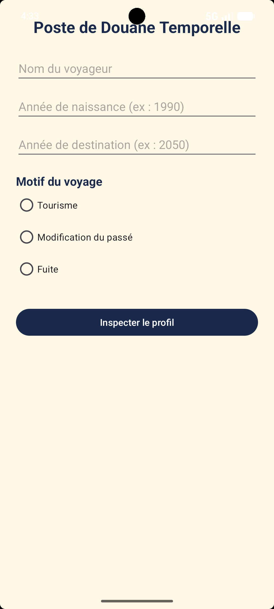
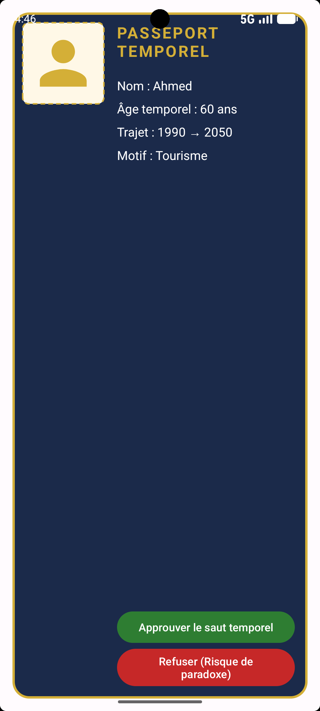
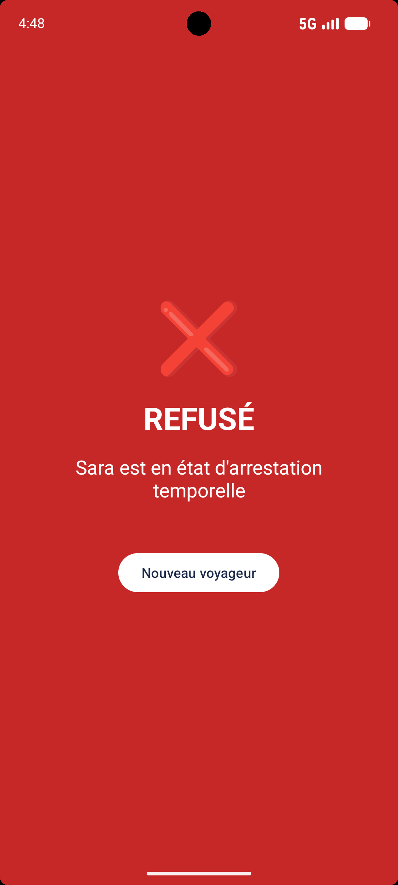

# Douane Temporelle — Mini Projet Programmation Mobile (3ème BI FSEGT)

## Membres
- Eya Khazri : setup, Activité 1 (formulaire), classe Cles
- Ines Yaakoubi : Activité 2 (passeport, nombre premier)
- Baya Meddeb : Activité 3 (verdict), navigation, tests

## Infos
- Matricule utilisé pour les clés : 3002
- Initiales utilisées dans les IDs : _ea

## Captures d'écran

 